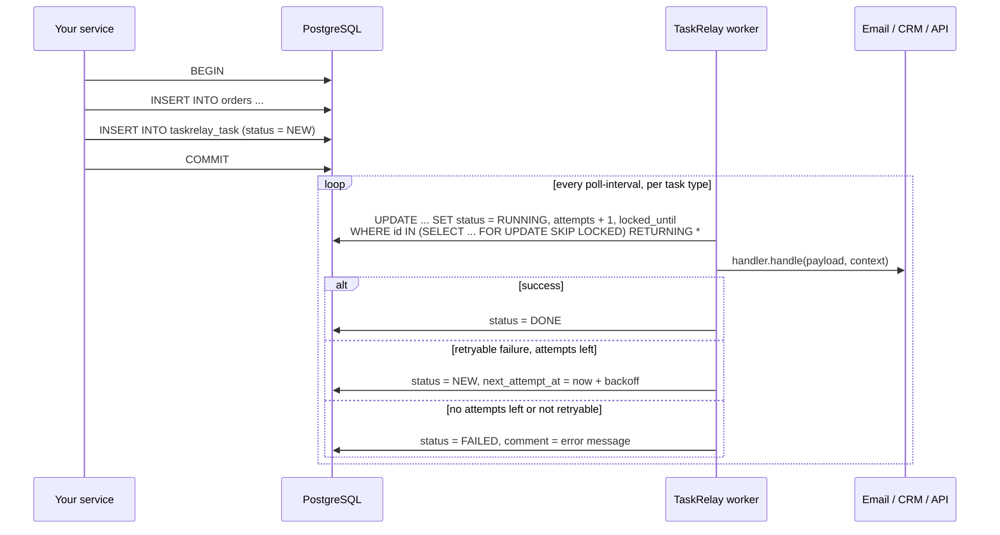

# TaskRelay

**Transactional outbox and durable background tasks for Spring Boot on PostgreSQL. No Kafka, no RabbitMQ, no extra infrastructure. Your existing database holds the queue.**

[](https://jitpack.io/#yanisderbikov/taskrelay)
[](LICENSE)


[Русская версия](README.ru.md)

You save an order and then need to send an email, create a CRM lead, or call another microservice. TaskRelay writes that intent into the **same database transaction** as the order. A background worker then delivers it with retries, exponential backoff, delays and deduplication, and it is safe to run several instances at once (`SELECT … FOR UPDATE SKIP LOCKED`).

```java
@Transactional
public void placeOrder(Order order) {
    orders.save(order);
    taskQueue.enqueue(new OrderConfirmationEmail(order.getId()));
}

@Component
class OrderConfirmationEmailHandler extends TaskHandler<OrderConfirmationEmail> {

    OrderConfirmationEmailHandler() {
        super("ORDER_CONFIRMATION_EMAIL", OrderConfirmationEmail.class);
    }

    @Override
    protected void handle(OrderConfirmationEmail payload, TaskContext context) {
        mailer.send(payload.orderId(), context.idempotencyKey());
    }

    @Override
    protected int maxAttempts() {
        return 6;
    }
}
```

If the transaction rolls back, the email is never sent. If the mail server is down, the task waits and retries. If the app restarts mid-way, nothing is lost.

---

## Contents

- [The problem](#the-problem)
- [Features](#features)
- [Quick start](#quick-start)
- [How it works](#how-it-works)
- [Delivery guarantees](#delivery-guarantees)
- [Retries and failures](#retries-and-failures)
- [Delayed and scheduled tasks](#delayed-and-scheduled-tasks)
- [Deduplication](#deduplication)
- [Configuration](#configuration)
- [Database schema](#database-schema)
- [Running several instances](#running-several-instances)
- [Inspecting and retrying tasks](#inspecting-and-retrying-tasks)
- [Testing your handlers](#testing-your-handlers)
- [Migrating from a hand-rolled task table](#migrating-from-a-hand-rolled-task-table)
- [When to use something else](#when-to-use-something-else)
- [FAQ](#faq)
- [Using TaskRelay with Claude Code](#using-taskrelay-with-claude-code)
- [Building from source](#building-from-source)
- [History](#history)

---

## The problem

Every backend eventually has to do something **outside** its database after changing something **inside** it. This is the *dual write problem*, and the usual first attempts all break:

| Attempt | What goes wrong |
|---|---|
| Call the HTTP API inside `@Transactional` | The email is sent, then the transaction rolls back. The customer gets a confirmation for an order that does not exist. Meanwhile slow API calls hold a DB connection and row locks. |
| Call it after commit, with `@TransactionalEventListener(AFTER_COMMIT)` or `@Async` | The commit succeeds, the call fails or the pod restarts, and the side effect is **lost forever**. Nothing remembers that it still has to happen. |
| Wrap the call in Spring Retry or Resilience4j | Retries live in memory. They block the request thread and vanish on restart. "Retry three times" does not cover a provider being down for twenty minutes. |
| Write your own `task` table and a `@Scheduled` poller | This works, until a second instance picks up the same rows, a crashed worker leaves tasks `RUNNING` forever, or someone copies it into another service where it slowly drifts. |

The fix is the **transactional outbox pattern**: store the intent in the same transaction as the business change, and let a background worker deliver it. TaskRelay is that pattern as a small Spring Boot starter, built on a plain PostgreSQL table.

Typical searches that lead here:

- *send email after transaction commit spring boot*
- *transactional outbox pattern spring boot without kafka / without debezium*
- *dual write problem database and http call*
- *@TransactionalEventListener event lost on restart*
- *@Async task lost when application restarts*
- *postgres job queue select for update skip locked java*
- *retry failed api call later with exponential backoff spring*
- *persistent background jobs postgresql spring boot*
- *prevent duplicate job processing across multiple instances*
- *idempotent background job / deduplicate enqueued jobs*

## Features

- **Transactional enqueue.** `taskQueue.enqueue(payload)` runs inside your current transaction, whether it is JPA/Hibernate, `JdbcTemplate` or jOOQ on the same `DataSource`.
- **Typed handlers.** One `TaskHandler<P>` subclass per task type, with your own payload class (records welcome).
- **Retries with exponential backoff.** These are set per handler: `maxAttempts()`, `retryable(e)` and `retryDelay(attempt)`.
- **Delays.**
  - Run at a given instant: `withRunAt` / `withDelay`.
  - Process tasks only once they are N minutes old: `delay()`.
- **Deduplication.** `withDedupeKey("payment-42")` makes a repeated enqueue a no-op, enforced by a unique index.
- **Multi-instance safe.** Tasks are claimed with `FOR UPDATE SKIP LOCKED`. A crashed worker's tasks are picked up again after `lock-timeout`.
- **Graceful shutdown.** Claimed tasks that have not started yet go back to the queue.
- **Per-type throughput.** `batch-size`, `poll-interval`, `lock-timeout` and `enabled` can be set for each task type, which is handy for provider rate limits.
- **Dedicated threads** for slow handlers, so they do not hold up the others.
- **Self-managing schema.** The table is created if missing. Columns are added to an existing table in place, and this runs after Flyway or Liquibase.
- **Jackson or Gson payloads**, or bring your own `TaskPayloadCodec`.
- **Optional retention cleanup** of finished tasks.
- **Small footprint.** No broker, no dashboard server, no bytecode magic. About a dozen classes on top of `spring-jdbc`.

## Quick start

**1. Add the dependency** (via JitPack).

Maven:

```xml
<repositories>
    <repository>
        <id>jitpack.io</id>
        <url>https://jitpack.io</url>
    </repository>
</repositories>

<dependency>
    <groupId>com.github.yanisderbikov</groupId>
    <artifactId>taskrelay</artifactId>
    <version>0.1.0</version>
</dependency>
```

Gradle (Kotlin DSL):

```kotlin
repositories { maven("https://jitpack.io") }
dependencies { implementation("com.github.yanisderbikov:taskrelay:0.1.0") }
```

Your app needs a PostgreSQL `DataSource` (`spring-boot-starter-jdbc` or `spring-boot-starter-data-jpa`).

**2. Describe the work as a payload.** Keep it small: ids rather than whole entities.

```java
public record WelcomeEmail(UUID userId) {
}
```

**3. Write a handler.**

```java
@Component
class WelcomeEmailHandler extends TaskHandler<WelcomeEmail> {

    private final Users users;
    private final Mailer mailer;

    WelcomeEmailHandler(Users users, Mailer mailer) {
        super("WELCOME_EMAIL", WelcomeEmail.class);
        this.users = users;
        this.mailer = mailer;
    }

    @Override
    protected void handle(WelcomeEmail payload, TaskContext context) {
        User user = users.findById(payload.userId()).orElseThrow();
        mailer.send(user.email(), "Welcome!", context.idempotencyKey());
    }

    @Override
    protected int maxAttempts() {
        return 5;
    }
}
```

**4. Enqueue inside your business transaction.**

```java
@Transactional
public User register(SignUp request) {
    User user = users.save(new User(request.email()));
    taskQueue.enqueue(new WelcomeEmail(user.id()));
    return user;
}
```

That is all. On startup TaskRelay creates the `taskrelay_task` table, starts a worker per handler, and processes tasks every 5 seconds.

## How it works



- **Enqueue.** `enqueue` is a single `INSERT` through `spring-jdbc`, which joins whatever transaction is active on the same `DataSource`. That includes JPA's `JpaTransactionManager`. No transaction means autocommit.
- **Polling.** Each handler gets its own worker. A worker claims up to `batch-size` due tasks in one statement, then runs them one by one.
- **Claiming.** It marks the rows `RUNNING` and stamps `locked_until = now + lock-timeout`. Other instances skip the locked rows and claim different ones.
- **Statuses.** A task moves `NEW → RUNNING → DONE`, or back to `NEW` with a later `next_attempt_at`, or ends as `FAILED` with the error message in `comment`.

## Delivery guarantees

| Handler setting | Guarantee | Use it for |
|---|---|---|
| `maxAttempts() == 1` (default) | **At most once.** A failure is final, and a task whose worker died mid-flight is marked `FAILED` instead of re-running. | Side effects that must never be duplicated and cannot be made idempotent. |
| `maxAttempts() > 1` | **At least once.** Failures are retried, and a task whose worker died is picked up again after `lock-timeout`. | Anything you can make idempotent: emails with an idempotency key, upserts, PUTs, payments with idempotency keys. |

`context.idempotencyKey()` returns `task:<uuid>`. It is stable across every attempt of the same task, so pass it to downstream APIs that support idempotency keys: payment providers, email gateways, your own microservices.

## Retries and failures

Override these in your handler:

| Method | Default | Meaning |
|---|---|---|
| `maxAttempts()` | `1` | Total attempts, including the first one. |
| `retryable(Exception e)` | `true` | Return `false` for permanent errors (validation, 4xx) to fail at once. |
| `retryDelay(int attempt)` | 1m, 2m, 4m, 8m … capped at 1h | Backoff after attempt *n* fails. |
| `delay()` | `0` | Do not process a task until it is at least this old. |
| `dedicatedThread()` | `false` | Run this type on its own thread so slow calls do not stall other types. |

```java
@Override
protected boolean retryable(Exception e) {
    return !(e instanceof InvalidRecipientException);
}

@Override
protected Duration retryDelay(int attempt) {
    return Duration.ofMinutes(5L * attempt);
}
```

When a payload cannot be deserialized, the task fails without calling the handler.

## Delayed and scheduled tasks

Run a task at a specific time:

```java
taskQueue.enqueue(new TrialEndingEmail(userId),
        EnqueueOptions.defaults().withRunAt(trialEndsAt.minus(Duration.ofDays(1))));

taskQueue.enqueue(new ReminderPush(userId),
        EnqueueOptions.defaults().withDelay(Duration.ofHours(2)));
```

Or give every task of a type a grace period. For example, "check in 30 minutes whether a manager replied to the customer":

```java
@Override
protected Duration delay() {
    return Duration.ofMinutes(30);
}
```

TaskRelay is not a cron replacement. For recurring jobs keep using `@Scheduled` and let the scheduled method enqueue tasks.

## Deduplication

Payment providers send the same webhook twice, and users double-click. Give the task a natural key:

```java
Optional<UUID> id = taskQueue.enqueue(new FailedPaymentLead(paymentId),
        EnqueueOptions.defaults().withDedupeKey(paymentId.toString()));
```

If a task of the same type with the same key already exists, in any status, nothing is inserted and an empty `Optional` comes back. Uniqueness is enforced by a partial unique index on `(type, dedupe_key)`, so it holds under concurrency too. It also works inside a transaction: `INSERT … ON CONFLICT DO NOTHING` does not abort it.

## Configuration

All properties are optional.

| Property | Default | Description |
|---|---|---|
| `taskrelay.enabled` | `true` | Turns the whole starter off. |
| `taskrelay.table-name` | `taskrelay_task` | Table to use, optionally schema-qualified (`jobs.task`). |
| `taskrelay.payload-format` | `jackson` | `jackson` (uses your `ObjectMapper` bean) or `gson`. |
| `taskrelay.poll-interval` | `5s` | Pause between batches, per type. |
| `taskrelay.initial-delay` | `10s` | Delay before the first poll after startup. |
| `taskrelay.batch-size` | `50` | Tasks claimed per poll, per type. |
| `taskrelay.lock-timeout` | `15m` | How long a claimed batch is reserved. It must be longer than processing a whole batch takes. |
| `taskrelay.threads` | `1` | Shared worker threads for all types without a dedicated thread. |
| `taskrelay.shutdown-timeout` | `30s` | How long to wait for running tasks on shutdown. |
| `taskrelay.retention` | *(keep forever)* | Delete `DONE` tasks older than this, for example `30d`. |
| `taskrelay.worker.enabled` | `true` | `false` keeps `TaskQueue` working but starts no workers. Useful in tests or API-only replicas. |
| `taskrelay.schema.auto-create` | `true` | `false` if you manage the table with your own migrations. |
| `taskrelay.types[TYPE].batch-size` | — | Per-type override. |
| `taskrelay.types[TYPE].poll-interval` | — | Per-type override. |
| `taskrelay.types[TYPE].lock-timeout` | — | Per-type override. |
| `taskrelay.types[TYPE].enabled` | — | `false` pauses one type. |

```properties
taskrelay.types[NEWSLETTER].batch-size=5
taskrelay.types[NEWSLETTER].poll-interval=1m
```

Use the bracket notation for type keys. Spring Boot drops `_` from map keys written without brackets. TaskRelay matches keys case-insensitively, ignoring punctuation, so `WELCOME_EMAIL`, `welcome-email` and `welcomeemail` all mean the same type.

TaskRelay uses its own threads and does **not** need `@EnableScheduling`. It also does not touch the `TaskScheduler` your `@Scheduled` methods use.

## Database schema

With `taskrelay.schema.auto-create=true` (the default), TaskRelay runs idempotent DDL at startup, after Flyway or Liquibase:

- If the table is missing, it creates it together with an index on `(type, status, created_at)`.
- It adds any missing columns, so a legacy `task` table from an older hand-rolled implementation is upgraded in place.
- It creates the partial unique index used for deduplication.

To own the schema yourself, set `taskrelay.schema.auto-create=false` and add this migration:

```sql
CREATE TABLE taskrelay_task (
    id              UUID PRIMARY KEY,
    type            VARCHAR(255) NOT NULL,
    payload         TEXT,
    status          VARCHAR(32)  NOT NULL,
    dedupe_key      VARCHAR(255),
    attempts        INTEGER      NOT NULL DEFAULT 0,
    comment         TEXT,
    next_attempt_at TIMESTAMPTZ,
    locked_until    TIMESTAMPTZ,
    created_at      TIMESTAMPTZ  NOT NULL DEFAULT now(),
    updated_at      TIMESTAMPTZ
);
CREATE INDEX taskrelay_task_due_idx ON taskrelay_task (type, status, created_at);
CREATE UNIQUE INDEX taskrelay_task_dedupe_key_uq ON taskrelay_task (type, dedupe_key) WHERE dedupe_key IS NOT NULL;
```

`type` and `status` are plain strings. Renaming a handler's type leaves existing rows of the old type unprocessed, so migrate them with an `UPDATE`.

## Running several instances

Run as many replicas as you like against one database:

- **Disjoint batches.** Claiming is a single `UPDATE … WHERE id IN (SELECT … FOR UPDATE SKIP LOCKED) RETURNING *`, so concurrent workers never get the same row.
- **Crashed workers.** If a replica dies with a claimed batch, the rows stay `RUNNING` until `locked_until` passes. Then another replica picks them up (when `maxAttempts() > 1`) or marks them `FAILED` (at-most-once handlers).
- **Lock timeout.** Set `lock-timeout` longer than the slowest batch can take, or lower `batch-size`.

## Inspecting and retrying tasks

`TaskQueue` doubles as a small read API for admin screens:

```java
List<TaskRecord> recent = taskQueue.findByType("RECEIPT_EMAIL", 50);
ReceiptEmail payload = taskQueue.payload(recent.get(0), ReceiptEmail.class);
taskQueue.retry(failedTaskId);
```

`retry` moves a `FAILED` task back to `NEW` with its attempts reset.

Handy SQL for operations:

```sql
SELECT type, status, count(*) FROM taskrelay_task GROUP BY 1, 2 ORDER BY 1, 2;

SELECT id, type, attempts, comment, updated_at
FROM taskrelay_task WHERE status = 'FAILED' ORDER BY updated_at DESC LIMIT 50;

UPDATE taskrelay_task SET status = 'NEW', attempts = 0, next_attempt_at = NULL
WHERE status = 'FAILED' AND type = 'WELCOME_EMAIL';
```

## Testing your handlers

Handlers are plain classes. Call `handle` directly from a test in the handler's package; no database or Spring context is needed:

```java
@Test
void sendsWelcomeEmail() throws Exception {
    WelcomeEmailHandler handler = new WelcomeEmailHandler(users, mailer);

    handler.handle(new WelcomeEmail(userId), new TaskContext(UUID.randomUUID(), "WELCOME_EMAIL", 1, Instant.now()));

    verify(mailer).send(eq("ann@example.com"), any(), any());
}
```

In `@SpringBootTest` you usually want `taskrelay.worker.enabled=false`, so you can assert what was enqueued (`taskQueue.findByType(...)`) without a background thread racing your test.

## Migrating from a hand-rolled task table

TaskRelay was extracted from exactly such a setup (see [History](#history)), so it is designed to adopt an existing table:

1. Point it at your table with `taskrelay.table-name=task`. Missing columns are added at startup and existing rows stay valid. It needs columns `id UUID`, `type`, `payload`, `status`, `created_at`, and status values `NEW` / `RUNNING` / `DONE` / `FAILED`.
2. Keep your payload format. If payloads were written with Gson, set `taskrelay.payload-format=gson`.
3. Turn each runner into a `TaskHandler` whose `type` equals the string already stored in the table, usually your old enum's `name()`.
4. Delete your entity, repository, poller and enum. Calls like `taskAdder.addTask(payload)` become `taskQueue.enqueue(payload)`.

## When to use something else

TaskRelay is deliberately small. Pick something else when:

| You need | Consider |
|---|---|
| Recurring or cron jobs with a persistent schedule | `@Scheduled` + ShedLock, db-scheduler, Quartz |
| A dashboard, a job UI and lambda-style jobs | JobRunr |
| Streaming domain events to many consumers, replay, high throughput | Kafka with Debezium / a CDC outbox |
| Reliable delivery of Spring application events between modules | Spring Modulith's event publication registry |
| MySQL, Oracle or SQL Server | Not supported. TaskRelay relies on PostgreSQL's `SKIP LOCKED` and `ON CONFLICT` |

TaskRelay fits best when you already run PostgreSQL and want business side effects (emails, CRM calls, webhooks, calls to your own microservices) to be **transactional, retried and visible in a table you can query**, without new infrastructure.

## FAQ

**Does it work with Spring Data JPA / Hibernate?**
Yes. `enqueue` uses `spring-jdbc` on the same `DataSource`, and Spring's `JpaTransactionManager` exposes its connection to it, so the insert commits or rolls back with your entities. This is covered by the test suite.

**Do I need Kafka, RabbitMQ or Redis?**
No. The queue is one PostgreSQL table.

**How fast is it?**
It is a polling queue. Per type, throughput is at most `batch-size` tasks per `poll-interval` plus however long your handlers take. It is built for business side effects (hundreds or thousands per minute), not for event streaming at millions per second.

**What happens during a deploy?**
On shutdown, workers stop claiming, finish the task in progress (up to `shutdown-timeout`), and return the rest of the claimed batch to `NEW`. With rolling deploys, old and new replicas share the work safely.

**Can a producer-only service enqueue tasks that another service processes?**
Yes, if both use the same database: `enqueue(payload, EnqueueOptions.defaults().withType("TYPE"))` and `taskrelay.worker.enabled=false` on the producer.

**Is the payload encrypted?**
No. It is stored as JSON text. Store ids, not secrets.

**Which versions are supported?**
Java 17+, Spring Boot 3.x (built against 3.2), PostgreSQL 9.6+. The tests run on PostgreSQL 16.

## Using TaskRelay with Claude Code

The repository ships a Claude Code skill that teaches Claude how to add task types, pick a retry policy, write tests, and avoid the classic outbox mistakes. Install it as a plugin:

```text
/plugin marketplace add yanisderbikov/taskrelay
/plugin install taskrelay@taskrelay
```

Or copy the skill into your project:

```bash
mkdir -p .claude/skills/taskrelay && curl -fsSL https://raw.githubusercontent.com/yanisderbikov/taskrelay/main/claude-plugin/skills/taskrelay/SKILL.md -o .claude/skills/taskrelay/SKILL.md
```

After that, asking Claude to "send a welcome email after sign-up" or "retry the CRM call if it fails" produces a payload, a handler and a transactional `enqueue`, instead of an HTTP call inside `@Transactional`.

## Building from source

```bash
mvn verify
```

The integration tests start PostgreSQL with Testcontainers, so Docker must be running. Releases are git tags, built by JitPack.

## History

TaskRelay was extracted from production rather than designed up front.

**June 2026.** The backend of [anyforms](https://anyforms.ru), a small Russian e-commerce and education business, needed to email a customer after a payment. Instead of sending it right inside the payment webhook, the email became a row in a `task` table, and a `@Scheduled` runner picked rows up and sent them.

**Summer–autumn 2026.** The same trick kept paying off. It grew to a dozen task types:
- purchase and receipt emails;
- amoCRM leads for paid and failed payments;
- CDEK delivery status emails;
- promo codes from site pop-ups;
- sales-bot runs;
- a delayed "did a manager answer the customer within 30 minutes?" check.

Each new need added a feature to the runner: retries with backoff for delivery emails, and a dedicated thread for slow CRM checks.

**August 2026.** A second service, the course platform, needed "a new module is open" emails, so the task code was copied into it. The copy froze on that day: it never got retries, the overlap guard or the dedicated thread.

**November 2026.** Emails were being moved into their own microservice. The obvious question came up: why put a task in a table at all, rather than call the email service over HTTP with three retries? Answering it meant spelling out the outbox reasoning:
- atomicity with the business transaction;
- no blocked threads while holding DB locks;
- surviving restarts;
- a stable idempotency key per task.

Looking closely also turned up the weak spots of the home-grown version:
- four email runners never retried;
- two instances could claim the same row;
- a crash left tasks `RUNNING` forever;
- the deduplication check scanned payloads with `LIKE`.

Instead of fixing the same code twice, it was extracted into this library, with the missing pieces built in from the start: `SKIP LOCKED` claiming, lock expiry, real delays, dedupe keys, string task types and a schema that upgrades the old tables in place. Both services are moving onto TaskRelay, and every next service starts with it.

Author: [Yan Derbikov](https://github.com/yanisderbikov).

## License

[Apache License 2.0](LICENSE)
